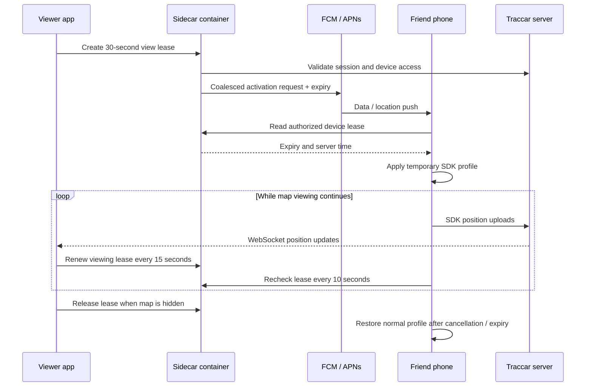

# Friend map live tracking

Opening the Map tab requests a short-lived live tracking session for the devices
shown on the map. The app renews that session every 15 seconds while the tab is
visible and the app is resumed. Leaving the tab or backgrounding the app releases
the session. A disconnected viewer's session expires after 30 seconds.

The Docker sidecar authenticates each viewer against Traccar and verifies access
to every requested device. Multiple viewers share a device session: one viewer
leaving does not stop another viewer's session. A push starts a session; devices
then check the sidecar every 10 seconds to obtain renewals or cancellation. There
is no push per location update or per viewer renewal. The native temporary profile
requests high accuracy, zero distance threshold, a five-second interval, and no
stationary stop detection. The normal profile restores medium accuracy, 100 metres,
600 seconds, and the SDK's normal stop detection. These are SDK inputs: iOS can
report each available fix when the distance threshold is zero, and neither OS
guarantees a five-second cadence.

Positions are collected and uploaded through Traccar Client SDK 1.0.11. Map marker
updates continue through the existing Traccar `/api/socket` connection. The sidecar
does not receive or store coordinates.

## Notification and position flow



FCM and APNs carry an activation request and expiry, not coordinates. Position data
travels directly from the phone's Traccar SDK to Traccar. A second viewer keeps the
same device lease active; leaving one map does not cancel another viewer's session.

## Components

- `lib/services/tracking/live_tracking_service.dart`: registration and viewer leases.
- `lib/app_state.dart` and `lib/screens/home_screen.dart`: map visibility,
  app lifecycle, authenticated session, device list, and reset.
- `android/.../live/`: native FCM handler and temporary SDK configuration controller.
- `ios/LiveTrackingSDK`: local native SDK adapter used by Runner and its extension.
  This adds integration around upstream Traccar's binary SDK; it does not change the
  upstream Kotlin sources or require a separately rebuilt Traccar framework. The
  Flutter dependency is pinned to match the adapter's native SDK version.
- `ios/LocationPushService`: APNs location push extension.
- `sidecar/`: HTTP service, SQLite token registry, APNs/FCM senders, Docker configuration.

The feature is opt-in at login. Enter an HTTPS live-tracking URL in the manual
connection form or include it in the provisioning QR code. Leaving it blank
continues ordinary tracking without registration or viewing sessions. The URL is
saved with the connection settings; no compile-time flag is needed.

## Deploy alongside Traccar

Use Node 24 or later for local development. The container includes Node 24.

1. Attach Traccar and the sidecar to the same Docker network. The supplied Compose
   file expects an existing external network named `traccar`. Set `networks.traccar.name`
   in `sidecar/compose.yaml` to your actual network name. Traccar must be resolvable as `traccar`, or change
   `TRACCAR_MANAGER_URL` to its service name and manager port.
2. Edit the inline `environment` options in `sidecar/compose.yaml` and create
   `sidecar/secrets/`. No `.env` file is needed.
3. Mount a Firebase service-account JSON file as `firebase-service-account.json` and
   your APNs key as `AuthKey.p8`. Fill in the Apple key ID, team ID, and bundle ID.
   Set `APNS_SANDBOX=true` for development provisioning, `false` for TestFlight/store.
   The supplied service sends Android **normal-priority data messages**. No Firebase
   or Apple credentials belong in the mobile application or Git.
4. Run:

   ```sh
   cd sidecar
   docker compose pull
   docker compose up -d
   ```

5. Expose the service through an HTTPS reverse proxy. The host binding is
   `127.0.0.1:8081`, so a host proxy can reach it. A proxy in Docker can instead join
   the same network and use `http://live-tracking:8080`. Forward `/v1/*` unchanged.
   Do not log `X-Traccar-Session` or `Authorization` headers. Internal Traccar traffic
   may use HTTP on the private Docker network; mobile-to-sidecar traffic must use
   HTTPS. This service is tied to one configured Traccar instance.
6. Set the public sidecar URL (for example `https://live.example.com`) in the
   app's **Live tracking URL (optional)** login field, or generate a base64 QR
   code with this UTF-8 payload:

   ```text
   v2;https://client.example.com;https://manager.example.com;https://live.example.com;manager@example.com;password
   ```

   Existing installations can reset their connection and log in again with the
   updated settings. Legacy four-field QR codes leave live tracking disabled.

Device ownership is recorded automatically during onboarding; there is no
`device-owners.json` file or per-user container configuration. The username entered
in the app is the SDK's Traccar `uniqueId`, separate from the shared manager login.

When an existing username is entered, the app shows a warning. Choosing **Use on
this phone** revokes the previous phone's live-tracking token immediately, even
before a new push token is available. The existing Traccar device, history, picture,
and sharing are preserved; its display name is updated. Stop ordinary tracking on
the old phone to avoid two SDKs uploading locations under the same username. The
sidecar cannot remotely disable ordinary SDK uploads.

Each installation keeps a random credential in secure storage. Normal reconnects
and push-token refreshes must present that credential, so a replaced phone cannot
silently reclaim its registration or unregister the replacement. Explicit takeover
is permitted for any authenticated account with access to the device. The warning
is a confirmation, not proof of personal identity; shared manager credentials allow
users to deliberately take over any accessible username. First names can repeat;
only duplicate device usernames trigger takeover.

When a live-tracking URL is configured, onboarding must successfully claim the
device before completing. A sidecar outage during ordinary use still leaves normal
SDK tracking available. Installation credentials are retained across local setup
resets, scoped to the sidecar URL and username.

SQLite claims and registrations survive container restarts in the named volume.
Installation credentials and device API bearer tokens are stored only as hashes
on the server. Viewer leases are ephemeral; a sidecar restart ends them. Run one
sidecar instance: leases and push coalescing
are held in process memory. No changes to stock Traccar are required. Existing
SQLite databases gain the claims table automatically. Deploy the updated app with
the updated sidecar: older clients cannot register without an installation
credential. Existing registrations remain usable until a new installation claims
them. An old `DEVICE_OWNERS_FILE` setting or JSON file is no longer used.

## Container publishing

`.github/workflows/sidecar-image.yaml` tests and builds the sidecar when its files
change. Pushes to `main`, and manual workflow runs, publish
`ghcr.io/1upbyte/trakkar-sidecar:latest`, a branch tag, and a commit SHA tag.
Pull requests test and build without publishing. Images support Linux amd64 and arm64.
The most recent publication updates `latest`.

The workflow authenticates with GitHub's automatic `GITHUB_TOKEN` and requests
`packages: write`; no registry password or push-provider credentials are needed
for the build. The first image becomes available after the workflow runs on GitHub.
Compose pulls that image instead of building locally. To pin a deployment to a
particular revision, replace `latest` in `compose.yaml` with its `sha-<full-commit>` tag.

If the GHCR package is private, authenticate on the deployment host using a GitHub
personal access token with `read:packages` and `docker login ghcr.io`. Alternatively,
make the package public in its GitHub package settings to allow unauthenticated pulls.
Push-provider credentials remain mounted at runtime from
`sidecar/secrets/`; they are excluded from the Docker build context.

## Android setup and behavior

Add your Firebase Android app for `com.oneupbyte.trakkar`, download
`google-services.json`, and place it in `android/app/`. It is ignored by Git. The
Google Services Gradle plugin is applied only when that file exists. Without it,
ordinary tracking still builds but FCM registration is unavailable.

The native handler uses the SDK's existing configuration API. It only changes an
already enabled tracker, and does not launch a foreground service or permission
prompt from a push. The existing Traccar foreground location service carries the
ongoing tracking work. The handler rejects expired or excessively long requests;
the server can renew the active session only in bounded 30-second increments.

A temporary-profile marker is persisted before switching. On process startup the
controller restores the baseline before checking the current server session. A
failed renewal cannot extend the old expiry. Stopped tracking is not restarted by
an incoming push. Reset clears the local native registration as well as deleting
its sidecar registration when reachable.

Normal-priority FCM delivery may be delayed in Doze. High-priority silent pushes
are deliberately not used: FCM reserves high priority for user-visible content and
can downgrade silent traffic. Devices with a stopped/killed service, revoked
permissions, or aggressive battery restrictions may not activate immediately.
See [FCM priority rules](https://firebase.google.com/docs/cloud-messaging/android-message-priority)
and [Android foreground service restrictions](https://developer.android.com/develop/background-work/services/fgs/restrictions-bg-start).

## iOS setup and behavior

Open `ios/Runner.xcworkspace`. The project contains Runner and an embedded
`LocationPushService` extension. Both link the local `TrakkarLiveTrackingSDK`
package, which reuses upstream Traccar SDK 1.0.11. All current iOS plugins use
Swift Package Manager; the obsolete CocoaPods integration was removed.

Configure the same signing team for both targets, enable the Location Push Service
Extension entitlement and APNs capability in your developer account/provisioning,
and provision the App Group `group.com.oneupbyte.trakkar.live` for both targets.
If you change the bundle ID, update both targets, the App Group entitlements and
`LiveTrackingState.group`, plus the sidecar's `APNS_BUNDLE_ID`. Debug uses the APNs
development entitlement; Release/Profile use production.

Always and Precise location access remain required. Registration uses the separate
location push token from `startMonitoringLocationPushes`, not the ordinary alert
notification token. The APNs sender uses the `<bundle-id>.location-query` topic.

The extension checks the server session, writes its expiry into protected App Group
storage, signals an already-running main process, and uses the SDK to request and
upload a fix. It starts Core Location live updates for the handoff. The native main
app restores its Core Location sessions at launch, reads the shared lease, and
switches the SDK into the temporary profile. Native timers/session polling handle
expiry without depending on Flutter's UI isolate.

**High-frequency background handoff requires iOS 18 or later in this implementation**
(`CLServiceSession` plus `CLBackgroundActivitySession`). On iOS 15–17 the extension
can request a single SDK fix but the temporary continuous profile is not activated.
The extension declares the location background mode required by the SDK's
`allowsBackgroundLocationUpdates` setting. It uses its own SDK configuration/database, seeded from shared connection
information, and keeps that instance's normal tracker stopped. It does not share
Traccar's main-app SQLite queue or write Flutter secure session credentials to the
App Group. The shared bearer token only permits reading this device's live lease.

Apple documents handing long-running/high-frequency reporting to the main app
rather than sending repeated location pushes. This handoff remains subject to Core
Location execution and device state, and must be tested on physical iPhones. It is
not a guarantee that every push immediately launches continuous tracking.
[Apple location push documentation](https://developer.apple.com/documentation/corelocation/creating-a-location-push-service-extension)

The sidecar enforces at least 180 seconds between successful iOS kicks (15 seconds
for Android). Renewing an active session does not need another push. Opening a new
session immediately after one has ended can therefore be delayed on iOS. This
conservative coalescing protects Apple's approximately 360-events-per-day quota;
it does not represent an unlimited-live-tracking guarantee.

## HTTP contract

Viewer endpoints use `X-Traccar-Session: JSESSIONID=...`. The sidecar validates that
cookie with its configured Traccar manager; it does not accept a caller-supplied
manager URL or store the cookie persistently.

| Endpoint | Request | Response |
| --- | --- | --- |
| `POST /v1/devices` | `{uniqueId, platform, pushToken}`; owner only | `{deviceId, deviceToken}` |
| `DELETE /v1/devices` | `{deviceId}`; registered owner only | `{}` |
| `PUT /v1/views/<viewId>` | `{deviceIds:[...]}`; all targets must be accessible | `{expiresAt}` in epoch milliseconds |
| `DELETE /v1/views/<viewId>` | authenticated viewer | `{}` |
| `GET /v1/device-session` | `Authorization: Bearer <deviceToken>` | `{expiresAt,serverTime}`; expiry zero means inactive |
| `GET /health` | none | `{ok:true}` |

`viewId` is per viewer instance; it is not a device ID. Push payloads contain
`type=live_tracking` and a string `expiresAt` in epoch milliseconds. There is a
100-device limit per viewing session and a per-user authenticated API rate limit.
API requests fail closed if Traccar is unavailable. Device renewals use scoped
opaque tokens and calculate remaining lease time against the server clock.

## Verification

Automated checks:

```sh
cd sidecar
npm test
cd ..
flutter test test/services/live_tracking_service_test.dart test/services/tracker_service_test.dart
flutter analyze lib/services/tracking lib/services/tracker_service.dart lib/app_state.dart lib/screens/home_screen.dart
flutter build apk --debug
flutter build ios --simulator --debug --no-codesign
```

Before calling the deployment live, test with two provisioned physical devices:

1. Keep the tracked phone's app in the background with tracking enabled. Open the
   viewer's Map tab. Verify actual Traccar fix timestamps and WebSocket marker updates.
2. Keep the map visible longer than 30 seconds: verify the session extends without
   repeated pushes. Add another viewer, then close the first viewer's map.
3. Close the last viewer's map or disconnect it. Verify the normal profile returns
   within the lease lifetime plus an in-flight network request; no permanent live mode.
4. Stop/restart the tracked process during a session and verify baseline recovery.
5. Test Android Doze, iOS background handoff, lost connectivity, revoked location
   permission, and an unauthorized account attempting registration/viewing.
6. Reset the tracked app and verify its old device token no longer enables tracking.
7. On a second phone, enter the same username, cancel the warning, then repeat and
   confirm takeover. Verify the numeric Traccar device ID and history are retained,
   the old token is rejected, and reopening/resetting the old app cannot replace or
   unregister the new phone without an explicit takeover.

Build/test results do not establish APNs/FCM delivery or iOS handoff reliability.
Those require real signing, server credentials, and physical-device validation.

### Validation on main

- The 46-test Flutter regression suite passed, including live-session renewal,
  disabled configuration, and concurrent registration tests.
- An additional HomeScreen lifecycle test passed for inactive startup, tab changes,
  and disposal, bringing the total verified Flutter tests to 47.
- `flutter analyze --no-pub` completed with no issues.
- Android debug APK compilation passed after rebuilding stale QR scanner output.
- `flutter build ios --simulator --debug --no-codesign --no-pub` passed for Runner
  and its embedded location push extension using Swift Package Manager.
- Actual APNs/FCM delivery and background handoff remain physical-device checks;
  they require the deployed sidecar, provider credentials, and Apple provisioning.
