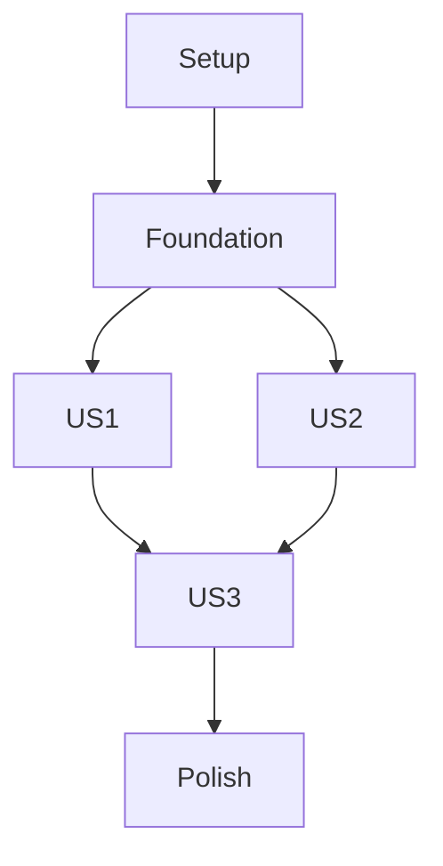

# Tasks: QR Login and First-Run Setup

**Input**: Design documents from `/specs/001-qr-login/`

**Prerequisites**: plan.md, spec.md, research.md, data-model.md, contracts/, quickstart.md

**Tests**: Included because the feature plan and constitution require parser, authentication, recovery, privacy, and platform verification.

**Organization**: Tasks are grouped by user story. This is the first implementation feature and creates the Flutter app foundation consumed by features 002–005.

## Phase 1: Setup

**Purpose**: Create the Flutter Android/iOS application scaffold on `spec-kit-rewrite`.

- [ ] T001 Create the Flutter project structure with `pubspec.yaml`, `lib/main.dart`, `android/`, `ios/`, and `test/`; set Android application ID and iOS bundle ID to `com.1upbyte.trakkar` in `android/app/build.gradle.kts` and `ios/Runner.xcodeproj/project.pbxproj`.
- [ ] T002 Add Flutter dependencies for QR scanning, secure storage, authenticated HTTP, and the official Traccar Client SDK in `pubspec.yaml`; configure Dart analysis and lint rules in `analysis_options.yaml`.

## Phase 2: Foundational

**Purpose**: Establish first-run routing, shared session state, and safe authenticated Traccar requests before onboarding stories.

- [ ] T003 Create `LoginDetailsDraft` and `SetupAttempt` models with the required username, password, absolute HTTP(S) client and manager URLs, source enum, state enum, and secret-free error representation in `lib/models/login_details.dart` and `lib/models/setup_attempt.dart`.
- [ ] T004 Authenticate against the manager URL's Traccar session endpoint, `POST /api/session`, and distinguish rejected credentials from network/service failures in `lib/services/auth/traccar_auth_service.dart`; do not include credentials or URL user-info in exceptions or logs.
- [ ] T005 Persist only successfully authenticated session/configuration values through secure storage in `lib/services/auth/secure_session_store.dart`; configure the official Traccar Client SDK with the client URL through `lib/services/tracking/traccar_tracking_service.dart`, but start reporting only after required location permission is granted.
- [ ] T006 Route fresh installs to setup and successful sessions to the signed-in app shell in `lib/app/app_router.dart` and `lib/main.dart`.

## Phase 3: User Story 1 - Set up from a QR code (Priority: P1)

**Goal**: Scan the external four-field QR format, validate it locally, review destinations, and submit only after confirmation.

**Independent Test**: Scan a valid producer-format fixture, confirm both destinations, and verify the shared sign-in flow receives the four expected values; malformed fixtures must not trigger a request.

### Tests for User Story 1

- [ ] T007 [P] [US1] Add golden parser tests for valid ASCII/non-ASCII values, trimming leading/trailing Base64 whitespace, rejecting internal Base64 whitespace, malformed Base64/UTF-8, wrong field counts, empty fields, embedded semicolons, and invalid URLs in `test/services/qr_payload_parser_test.dart`.
- [ ] T008 [P] [US1] Add QR onboarding widget tests for camera permission timing, scan/cancel/retry, safe destination preview, Base64 warning, and confirmation-before-authentication in `test/features/setup/qr_setup_flow_test.dart`.

### Implementation for User Story 1

- [ ] T009 [P] [US1] Implement strict single-pass Base64-to-UTF-8 parsing for exactly `user;password;clienturl;managerurl` with four non-empty fields; trim only leading/trailing payload whitespace and reject internal whitespace in `lib/services/auth/qr_payload_parser.dart`.
- [ ] T010 [US1] Implement the Scan QR flow and request camera permission only after selection in `lib/features/setup/qr_scan_screen.dart` and `android/app/src/main/AndroidManifest.xml`.
- [ ] T011 [US1] Add the required iOS camera usage description for QR scanning in `ios/Runner/Info.plist`.
- [ ] T012 [US1] Implement a destination-review screen showing normalized client/manager URLs, hiding the password and raw payload, explaining Base64 privacy, and requiring affirmative confirmation before calling `lib/services/auth/traccar_auth_service.dart` in `lib/features/setup/qr_destination_review.dart`.
- [ ] T013 [US1] Connect successful QR authentication to secure session persistence and signed-in routing in `lib/features/setup/qr_scan_screen.dart` and `lib/app/app_router.dart`.

## Phase 4: User Story 2 - Set up by entering details (Priority: P1)

**Goal**: Let users enter the same four required values manually and submit through the shared validation/authentication path.

**Independent Test**: Submit valid manual details and reach the signed-in shell; submit missing values or malformed URLs and verify field-specific correction while preserving other entries.

### Tests for User Story 2

- [ ] T014 [P] [US2] Add manual-entry widget tests for required fields, URL validation, masked password, retained editable values, and successful shared submission in `test/features/setup/manual_setup_form_test.dart`.

### Implementation for User Story 2

- [ ] T015 [US2] Implement the manual username/password/client URL/manager URL form with inline validation and password masking in `lib/features/setup/manual_setup_screen.dart`.
- [ ] T016 [US2] Route manual submissions through the same normalized `LoginDetailsDraft`, authentication service, secure session store, and signed-in route used by QR setup in `lib/features/setup/manual_setup_screen.dart`.

## Phase 5: User Story 3 - Recover from a failed sign-in (Priority: P2)

**Goal**: Distinguish rejected credentials from unavailable services and let users correct or retry without exposing secrets.

**Independent Test**: Simulate rejected credentials and unreachable endpoints; verify distinct actionable messages and an editable retry path with no secret values in rendered errors or captured logs.

### Tests for User Story 3

- [ ] T017 [P] [US3] Add authentication-flow tests for invalid credentials, unavailable manager/client endpoints, interrupted requests, service identification, sanitized opt-in error details, Back/Proceed Anyway outcomes, and secret-free diagnostics in `test/services/traccar_auth_service_test.dart`.
- [ ] T018 [P] [US3] Add recovery-state widget tests for the unavailable-service warning, initially hidden full error details, Back, Proceed Anyway navigation to the map without a session, the red connection-failure bar, Retry and bar dismissal after success, editing details, repeated scan prevention, and camera denial/revocation in `test/features/setup/setup_recovery_test.dart`.

### Implementation for User Story 3

- [ ] T019 [US3] Map authentication and transport failures to distinct safe error states without echoing credentials, raw payloads, scanner exceptions, or URL user-info in `lib/services/auth/traccar_auth_service.dart` and `lib/models/setup_attempt.dart`.
- [ ] T020 [US3] Implement the unavailable-service warning with service identification, opt-in sanitized full error details, Back to setup, Proceed Anyway navigation to the map without claiming authentication, retry/edit/manual fallback, and duplicate-submission prevention in `lib/features/setup/setup_recovery_view.dart`.
- [ ] T021 [US3] Implement a shared red top connection-failure bar reading “Connection to server failed” with a Retry button; show it for server connection failures across the app and dismiss it after successful retry in `lib/app/app_shell.dart` and `lib/widgets/server_connection_banner.dart`.
- [ ] T022 [US3] Clear transient QR/credential references after cancellation and after authentication completes in `lib/features/setup/qr_scan_screen.dart` and `lib/features/setup/manual_setup_screen.dart`.

## Phase 6: Polish and Cross-Cutting Concerns

- [ ] T023 Verify Android and iOS app identifiers and camera permission declarations in `android/app/build.gradle.kts`, `android/app/src/main/AndroidManifest.xml`, `ios/Runner.xcodeproj/project.pbxproj`, and `ios/Runner/Info.plist`.
- [ ] T024 Add setup flow and payload privacy checks to the onboarding coverage in `test/features/setup/` and `test/services/`; ensure logs/errors contain no QR payload, username, password, or URL user-info.
- [ ] T025 Run the QR feature validation commands and document Android/iOS build outcomes in `specs/001-qr-login/quickstart.md`.

## Dependencies and Execution Order

### Phase Dependencies

- Setup is first and creates the Flutter app used by every later feature.
- Foundational session/routing tasks block all three user stories.
- User Stories 1 and 2 can proceed independently after the foundation; Story 3 depends on the shared authentication result states from the foundation and both submission paths.
- Polish follows the three stories.

### Parallel Opportunities

- T007 and T008 can be authored in parallel; T009 and T010 touch separate files after the parser contract is understood.
- T014 can proceed independently of Story 1 UI; its integration task T016 uses the shared auth service.
- T017 and T018 can be authored in parallel.

### Parallel Execution Examples

| Story | Parallel tasks |
|---|---|
| US1 | T007 and T008 (parser and onboarding test files are separate). |
| US2 | T014 can run in parallel with US1's T007/T008 after the model contract is fixed; US2 has one focused test task. |
| US3 | T017 and T018 (service and recovery widget tests are separate). |

## Implementation Strategy

Deliver the scan flow as the MVP (US1), then manual entry (US2), then recovery hardening (US3). Keep both setup routes on one authentication/session path. Features 002–005 depend on this feature's scaffold and authenticated session boundary.

## Independent Story Checks

- US1: Valid QR fixture reaches confirmed sign-in; malformed fixtures produce no network request.
- US2: Valid manual details sign in; invalid fields remain editable and do not erase other entries.
- US3: Rejected credentials and unavailable services show different safe messages and allow retry/edit.

## Format Validation

Every task uses a checkbox, sequential ID, optional parallel marker, required user-story label for story tasks, and a concrete repository path.
