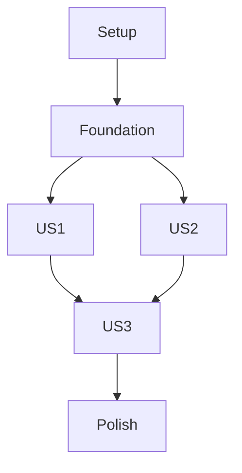

# Tasks: QR Login and First-Run Setup

**Input**: Design documents from `/specs/001-qr-login/`

**Prerequisites**: plan.md, spec.md, research.md, data-model.md, contracts/, quickstart.md

**Tests**: Included because the feature plan and constitution require parser, authentication, recovery, privacy, and platform verification.

**Organization**: Tasks are grouped by user story. This is the first implementation feature and creates the Flutter app foundation consumed by features 002–005.

## Phase 1: Setup

**Purpose**: Create the Flutter Android/iOS application scaffold on `spec-kit-rewrite`.

- [X] T001 Create the Flutter project structure with `pubspec.yaml`, `lib/main.dart`, `android/`, `ios/`, and `test/`; set Android application ID and iOS bundle ID to `com.oneupbyte.trakkar` in `android/app/build.gradle.kts` and `ios/Runner.xcodeproj/project.pbxproj`.

- [X] T002 Add Flutter dependencies for QR scanning, secure storage, authenticated HTTP, and the official Traccar Client SDK in `pubspec.yaml`; configure Dart analysis and lint rules in `analysis_options.yaml`.

## Phase 2: Foundational

**Purpose**: Establish first-run routing, shared session state, and safe authenticated Traccar requests before onboarding stories.

- [X] T003 Create `LoginDetailsDraft` and `SetupAttempt` models with required non-empty username/password/client URL/manager URL strings, source enum, state enum, and secret-free error representation in `lib/models/login_details.dart` and `lib/models/setup_attempt.dart`.
- [X] T004 Authenticate against the manager URL's Traccar session endpoint, `POST /api/session`, and distinguish rejected credentials from network/service failures in `lib/services/auth/traccar_auth_service.dart`; do not include credentials or URL user-info in exceptions or logs.
- [X] T005 Persist the successfully authenticated username, password, client URL, manager URL, and session values through platform secure storage for future authentication; never persist raw QR text or an unsuccessful draft in `lib/services/auth/secure_session_store.dart`. Configure the official Traccar Client SDK with the client URL through `lib/services/tracking/traccar_tracking_service.dart`, but start reporting only after Always and Precise location access are granted.
- [X] T006 Route fresh installs to setup with Scan QR and Enter Details choices plus the non-blocking Base64 privacy notice; route successful sessions to the signed-in app shell in `lib/app/app_router.dart` and `lib/main.dart`.

## Phase 3: User Story 1 - Set up from a QR code (Priority: P1)

**Goal**: Scan and locally parse the external four-field QR format, then immediately submit a valid payload for sign-in without an extra confirmation prompt.

**Independent Test**: Scan a valid producer-format fixture and verify the shared sign-in flow immediately receives the four expected values; malformed Base64 or field grammar must not trigger a request, and arbitrary non-empty URL values pass through without local validation.

### Tests for User Story 1

- [X] T007 [P] [US1] Add golden parser tests for valid ASCII/non-ASCII values, trimming leading/trailing Base64 whitespace, rejecting internal Base64 whitespace, malformed Base64/UTF-8, wrong field counts, empty fields, embedded semicolons, and accepting arbitrary non-empty URL field values in `test/services/qr_payload_parser_test.dart`.
- [X] T008 [P] [US1] Add QR onboarding widget tests for camera permission timing, scan/cancel/retry, the pre-scan Base64 privacy notice, immediate authentication after valid parsing, and an “Invalid QR code” popup with retry/manual entry and no request for invalid parsing in `test/features/setup/qr_setup_flow_test.dart`.

### Implementation for User Story 1

- [X] T009 [P] [US1] Implement strict single-pass Base64-to-UTF-8 parsing for exactly `user;password;clienturl;managerurl` with four non-empty fields; trim only leading/trailing payload whitespace, reject internal whitespace, and do not validate URL fields during parsing in `lib/services/auth/qr_payload_parser.dart`.
- [X] T010 [US1] Implement the Scan QR flow and request camera permission only after selection in `lib/features/setup/qr_scan_screen.dart` and `android/app/src/main/AndroidManifest.xml`.
- [X] T011 [US1] Add the required iOS camera usage description for QR scanning in `ios/Runner/Info.plist`.
- [X] T012 [US1] After successful local QR parsing, immediately call `lib/services/auth/traccar_auth_service.dart` without a destination-review or confirmation prompt; show only non-secret authentication progress and safe outcomes in `lib/features/setup/qr_scan_screen.dart`.
- [X] T013 [US1] Connect successful QR authentication to secure persistence of login details and session values, clear transient QR/credential references, and route to the signed-in app in `lib/features/setup/qr_scan_screen.dart` and `lib/app/app_router.dart`.

## Phase 4: User Story 2 - Set up by entering details (Priority: P1)

**Goal**: Let users enter the same four required values manually and submit through the shared validation/authentication path.

**Independent Test**: Submit non-empty manual details and reach the signed-in shell; submit missing values and verify field-specific correction while preserving other entries. Confirm URL strings are passed to the network layer without local URL validation.

### Tests for User Story 2

- [X] T014 [P] [US2] Add manual-entry widget tests for required non-empty fields, no local URL/password-format validation, masked password, retained editable values, and successful shared submission in `test/features/setup/manual_setup_form_test.dart`.

### Implementation for User Story 2

- [X] T015 [US2] Implement the manual username/password/client URL/manager URL form with required-field validation only and password masking; pass URL values unchanged to the network layer in `lib/features/setup/manual_setup_screen.dart`.
- [X] T016 [US2] Route manual submissions through the same `LoginDetailsDraft`, authentication service, secure login-details/session store, and signed-in route used by QR setup; pass URL values unchanged to the network layer in `lib/features/setup/manual_setup_screen.dart`.

## Phase 5: User Story 3 - Recover from a failed sign-in (Priority: P2)

**Goal**: Distinguish rejected credentials from unavailable services and let users correct or retry without exposing secrets.

**Independent Test**: Simulate rejected credentials and unavailable endpoints; verify distinct messages, Back/Retry/Proceed Anyway choices, retry resubmission, unauthenticated map routing after proceeding, and secret-free rendered errors/logs.

### Tests for User Story 3

- [X] T017 [P] [US3] Add authentication-flow tests for invalid credentials, unavailable manager/client endpoints, connection-interrupted requests, service identification, sanitized opt-in error details, Retry resubmission, Back/Retry/Proceed Anyway outcomes for both failure types, and secret-free diagnostics in `test/services/traccar_auth_service_test.dart`.
- [X] T018 [P] [US3] Add recovery-state widget tests for distinct rejected-credential and unavailable-service warnings, initially hidden full service-error details, Back/Retry/Proceed Anyway for both, retained form values on Back, map navigation without a session, server-failure bar/Retry, camera-permission bar/Re-ask, location-permission bar until Always and Precise are granted, blocked duplicate scans/submits while authentication is active, and scan cancellation/manual fallback in `test/features/setup/setup_recovery_test.dart`.

### Implementation for User Story 3

- [X] T019 [US3] Map authentication and transport failures to distinct safe error states without echoing credentials, raw payloads, scanner exceptions, or URL user-info in `lib/services/auth/traccar_auth_service.dart` and `lib/models/setup_attempt.dart`.
- [X] T020 [US3] Implement distinct rejected-credential and unavailable-service warnings, showing opt-in sanitized full error details for unavailable services, exactly Back, Retry, and Proceed Anyway for both, Retry using current credentials, Back to editable setup, Proceed Anyway to the map without claiming authentication, retry/edit/manual fallback, and duplicate-submission prevention in `lib/features/setup/setup_recovery_view.dart`.
- [X] T021 [US3] Implement a shared red top status bar with context-specific actions: server failure says “Connection to server failed” with Retry, which repeats the failed operation and resubmits transient login details when authentication was interrupted; denied/revoked camera or location access shows a permission request with Re-ask. Show the location variant until both Always and Precise are granted, and retain Enter Details as a camera-scan fallback in `lib/app/app_shell.dart` and `lib/widgets/server_connection_banner.dart`.
- [X] T022 [US3] Discard raw QR text immediately after parsing; retain decoded credentials only in memory for correction/retry, then persist them securely and clear transient references after successful authentication, or clear them when setup is abandoned in `lib/features/setup/qr_scan_screen.dart` and `lib/features/setup/manual_setup_screen.dart`.

## Phase 6: Polish and Cross-Cutting Concerns

- [X] T023 Verify Android and iOS app identifiers plus camera and Always/Precise location permission declarations in `android/app/build.gradle.kts`, `android/app/src/main/AndroidManifest.xml`, `ios/Runner.xcodeproj/project.pbxproj`, and `ios/Runner/Info.plist`.
- [X] T024 Add setup flow and payload privacy checks to the onboarding coverage in `test/features/setup/` and `test/services/`; ensure logs/errors contain no QR payload, username, password, or URL user-info.
- [X] T025 Document the external QR payload grammar, encoding, and privacy warning in the project `README.md`.
- [X] T026 Run the QR feature validation commands and document Android/iOS build outcomes in `specs/001-qr-login/quickstart.md`.

## Dependencies and Execution Order

### Phase Dependencies

- Setup is first and creates the Flutter app used by every later feature.
- Foundational session/routing tasks block all three user stories.
- User Stories 1 and 2 can proceed independently after the foundation; Story 3 depends on the shared authentication result states from the foundation and both submission paths.
- Polish follows the three stories.

### Parallel Opportunities

- T007 and T008 can be authored in parallel; T009 and T010 touch separate files after the parser contract is understood.
- T014 can proceed independently of Story 1 UI; its integration task T016 uses the shared auth service.
- T017 and T018 can be authored in parallel.

### Parallel Execution Examples

| Story | Parallel tasks |
|---|---|
| US1 | T007 and T008 (parser and onboarding test files are separate). |
| US2 | T014 can run in parallel with US1's T007/T008 after the model contract is fixed; US2 has one focused test task. |
| US3 | T017 and T018 (service and recovery widget tests are separate). |

## Implementation Strategy

Deliver the scan flow as the MVP (US1), then manual entry (US2), then recovery hardening (US3). Keep both setup routes on one authentication/session path. Features 002–005 depend on this feature's scaffold and authenticated session boundary.

## Independent Story Checks

- US1: Valid QR fixture immediately reaches sign-in after parsing; malformed fixtures produce no network request.
- US2: Valid manual details sign in; invalid fields remain editable and do not erase other entries.
- US3: Rejected credentials and unavailable services show different safe messages and allow retry/edit.

## Format Validation

Every task uses a checkbox, sequential ID, optional parallel marker, required user-story label for story tasks, and a concrete repository path.
