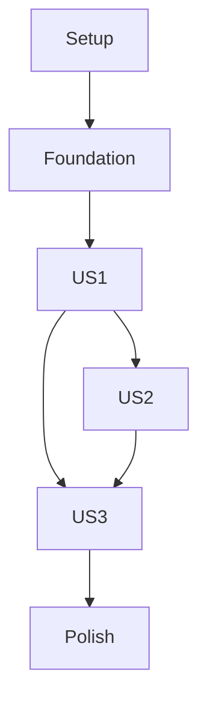

# Tasks: Map Home and People Overview

**Input**: Design documents from `/specs/002-map-home/`

**Prerequisites**: plan.md, spec.md, research.md, data-model.md, contracts/, quickstart.md

**Tests**: Included for the map policy, server data projection, selection, layer behavior, and platform builds required by the feature plan and project constitution.

**Organization**: Tasks are grouped by user story. Run after feature 001 has created the Flutter app and authenticated session boundary.

## Phase 1: Setup

**Purpose**: Add the shared Flutter map, vector-tile, cluster, and bounded cache dependencies.

- [X] T001 Add compatible Flutter map renderer, OpenFreeMap vector tile, marker clustering, coordinate, and tile-cache dependencies in `pubspec.yaml`.
- [X] T002 Add map feature folders and test folders under `lib/features/map/`, `lib/models/`, `lib/services/map/`, and `test/features/map/`.

## Phase 2: Foundational

**Purpose**: Connect authenticated device/position data and shared map state for all map stories.

- [X] T003 Define server-backed `Person`, `PersonLocation`, map view state, and map preference models with nullable image/battery/address state in `lib/models/person.dart`, `lib/models/person_location.dart`, and `lib/models/map_view_state.dart`.
- [X] T004 Implement one authorized-device/latest-position repository using the existing authenticated session and supported live update channel in `lib/services/traccar_data_repository.dart`; do not create a tracking loop or expose unauthorized devices.
- [X] T005 Implement shared map camera state and deterministic location-fit policy interfaces in `lib/features/map/map_camera_policy.dart` and `lib/features/map/map_state.dart`.
- [X] T006 Add the signed-in Map landing view and bottom-navigation placeholders ordered Map, People, Places, Settings to the shared app shell while preserving setup routing in `lib/app/app_shell.dart` and `lib/features/map/map_screen.dart`.

## Phase 3: User Story 1 - See people on the map (Priority: P1) 🎯 MVP

**Goal**: Show authorized people with known locations, circular portraits/initials, clustered without hiding members, and fit everyone within the roughly two-mile cap.

**Independent Test**: Open the map with empty, single, nearby, and widely spread positions; verify identity markers, selectable group members, and the documented fit cap.

### Tests for User Story 1

- [X] T007 [P] [US1] Add deterministic tests for empty/single/multiple location fit and the approximately two-mile outward framing cap in `test/features/map/map_camera_policy_test.dart`.
- [X] T008 [P] [US1] Add widget tests for portrait/initial markers, failed image loading, close-person clusters, member identity, and no-location behavior in `test/features/map/map_markers_test.dart`.

### Implementation for User Story 1

- [X] T009 [US1] Implement initial camera bounds and zoom policy for no known locations, one location, and multiple locations in `lib/features/map/map_camera_policy.dart`.
- [X] T010 [P] [US1] Implement circular person markers with image/initial fallback and explicit loading/error states in `lib/features/map/person_marker.dart`.
- [X] T011 [US1] Implement grouped markers that retain every member's visible identity and individual selection in `lib/features/map/person_cluster_marker.dart`.
- [X] T012 [US1] Render server-authorized current positions and apply the auto-fit policy when the Map tab opens in `lib/features/map/map_screen.dart`.

## Phase 4: User Story 2 - Inspect a person's status (Priority: P1)

**Goal**: Select an individual in or outside a group, show location/battery/update time, zoom to the person, and restore the exact prior camera on Back.

**Independent Test**: Select a marker and a grouped member; compare panel content, unavailable/stale labels, focus zoom, and Back camera restoration.

### Tests for User Story 2

- [X] T013 [P] [US2] Add tests for selection camera snapshots, focused selection, Back restoration, and repeated selection in `test/features/map/person_selection_test.dart`.
- [X] T014 [P] [US2] Add detail panel tests for name, location description, battery unknown state, stale timestamp, and missing-position state in `test/features/map/person_details_sheet_test.dart`.

### Implementation for User Story 2

- [X] T015 [US2] Implement a shared location description formatter that prefers containing saved-place/address data, then server reverse-geocode text, then coordinates in `lib/services/map/location_description.dart`.
- [X] T016 [US2] Implement the person details bottom sheet with name, last-known location, battery, and last update state in `lib/features/map/person_details_sheet.dart`.
- [X] T017 [US2] Wire marker and cluster-member selection to focus camera and snapshot the prior camera for Back restoration in `lib/features/map/map_screen.dart` and `lib/features/map/map_state.dart`.

## Phase 5: User Story 3 - Read map context and choose satellite detail (Priority: P2)

**Goal**: Show saved-place names as legible map context and switch between standard and satellite layers at the persisted threshold.

**Independent Test**: Load named server geofences, inspect label decluttering at different zooms, cross a configurable threshold, and verify standard-map fallback when no key is available.

### Tests for User Story 3

- [X] T018 [P] [US3] Add tests for saved-place label visibility/decluttering and label collision behavior across zoom levels in `test/features/map/place_labels_test.dart`.
- [X] T019 [P] [US3] Add tests for standard/satellite threshold changes, missing MapTiler key fallback, and cache identity excluding the `key` query parameter in `test/services/map/map_layer_config_test.dart`.
- [X] T020 [P] [US3] Add tests for server reverse-geocode use, location fallback order, shared connection-failure bar/retry behavior, location permission bar/Re-ask behavior until Always and Precise are granted, and secret-free map diagnostics in `test/services/map/location_description_test.dart`.

### Implementation for User Story 3

- [X] T021 [US3] Read authorized saved geofences and expose their names/boundaries to the map through the shared authenticated repository in `lib/services/traccar_data_repository.dart`.
- [X] T022 [US3] Implement named-place labels with area-aware zoom visibility and collision handling in `lib/features/map/place_labels_layer.dart`.
- [X] T023 [US3] Read the satellite key from authenticated `/api/server` attribute `trakkarMapTilerKey` into memory and configure MapTiler `satellite-v4` plus OpenFreeMap standard styles in `lib/services/map/map_layer_config.dart`.
- [X] T024 [US3] Implement the persisted satellite threshold with a new-install default of zoom 19 in `lib/models/map_appearance_preference.dart` and `lib/services/map/map_preferences.dart`.
- [X] T025 [US3] Configure the tile cache for 90-day freshness and a 512 MB maximum, excluding the MapTiler `key` query parameter from cache identity in `lib/services/map/map_tile_cache.dart`.
- [X] T026 [US3] Use authenticated Traccar reverse geocoding, preserve saved-place-first/address-second/coordinates-last fallback, route map-server failures and insufficient Always/Precise location permission to the shared status bar, and disclose satellite unavailability while keeping the standard map usable in `lib/services/map/location_description.dart` and `lib/features/map/map_screen.dart`.

## Phase 6: Polish and Cross-Cutting Concerns

- [X] T027 Review map and cluster semantics on supported phone/tablet layouts and light/dark themes in `lib/features/map/`.
- [X] T028 Run focused map tests and Android/iOS build checks; record results and any unavailable device/live-server verification in `specs/002-map-home/quickstart.md`.

## Dependencies and Execution Order

### Phase Dependencies

- Depends on feature 001 for the Flutter shell, secure authenticated session, and Traccar request boundary.
- Setup and Foundational phases block all map stories.
- US2 depends on person markers/data from US1. US3 uses the map foundation and is completed before feature 004 adds geofence creation/editing; expose its geofence read projection for that later feature to reuse.

### Parallel Opportunities

- T007/T008 and T010 can proceed in parallel after model contracts are stable.
- T013/T014 and T015/T016 can proceed in parallel across tests and separate files.
- T018/T019/T020 can proceed in parallel; layer config and label layer tasks may proceed in parallel after repository contracts are set.

### Parallel Execution Examples

| Story | Parallel tasks |
|---|---|
| US1 | T007/T008 test files can be authored in parallel; T010 can be built independently of the camera-policy implementation T009. |
| US2 | T013 and T014 (selection policy and detail-sheet tests use separate files). |
| US3 | T018/T019/T020 (label, layer-config, and location-description test files are separate). |

## Implementation Strategy

Deliver US1 as the map MVP, then add person inspection (US2), then saved-place context and satellite detail (US3). Across feature files, implement 001 first, then 002, then 004 and 005 (which can proceed in parallel after 002), then 003. Feature 004 extends the shared geofence projection with create/delete operations; feature 005 owns the user-facing threshold control and reset behavior.

## Independent Story Checks

- US1: All authorized located people are visible as identifiable markers; overview fit obeys the cap.
- US2: Direct and grouped selection show the same person details, and Back restores the pre-selection camera.
- US3: Saved-place labels remain legible, style switches at the saved threshold, and missing imagery credentials leave a usable standard map.

## Format Validation

Every task uses a checkbox, sequential ID, optional parallel marker, required user-story label for story tasks, and a concrete repository path.
