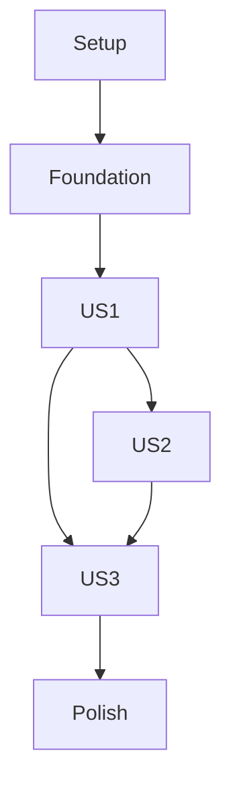

# Tasks: People Tab and Map Navigation

**Input**: Design documents from `/specs/003-people-tab/`

**Prerequisites**: plan.md, spec.md, research.md, data-model.md, contracts/, quickstart.md

**Tests**: Included for list completeness, stale/missing status, shared selection, and retained navigation state as required by the plan and constitution.

**Organization**: Tasks are grouped by user story. Integrate after features 001, 002, 004, and 005 provide the authenticated shell, Map selection, saved-place descriptions, and shared profile state.

## Phase 1: Setup

**Purpose**: Add People feature directories and connect them to shared app models.

- [X] T001 Create `lib/features/people/` and `test/features/people/` structure for the list, row, and navigation state.
- [X] T002 Replace the People placeholder with the People route in the shared bottom navigation order Map, People, Places, Settings in `lib/app/app_shell.dart`.

## Phase 2: Foundational

**Purpose**: Establish the authorized people projection and shared location status formatter before story UI.

- [X] T003 Project every Traccar-authorized device and latest position into the shared person model, preserving the server profile image and missing/stale status, in `lib/services/traccar_data_repository.dart`.
- [X] T004 Implement alphabetical name ordering and the shared saved-place/address/coordinate location description in `lib/features/people/people_list_state.dart` using `lib/services/map/location_description.dart`.

## Phase 3: User Story 1 - Browse everyone in the People tab (Priority: P1) 🎯 MVP

**Goal**: Show every authorized person with name, picture/initial, readable location, and honest missing/stale state.

**Independent Test**: Open People with multiple authorized devices, including missing, stale, and fresh positions, and verify all rows appear with accurate status and alphabetical order.

### Tests for User Story 1

- [X] T005 [P] [US1] Add list-state tests for all authorized entries, alphabetical ordering, refresh updates, and empty-list behavior in `test/features/people/people_list_state_test.dart`.
- [X] T006 [P] [US1] Add row widget tests for server profile image/initial fallback, readable place/address/coordinate text, missing location, and stale status in `test/features/people/person_row_test.dart`.

### Implementation for User Story 1

- [X] T007 [P] [US1] Implement a People row showing name, server image or initials, location text, and stale/unavailable state in `lib/features/people/person_row.dart`.
- [X] T008 [US1] Implement the People list loading, empty, error, refresh, and alphabetical data states in `lib/features/people/people_screen.dart` and `lib/features/people/people_list_state.dart`.

## Phase 4: User Story 2 - Open a person's map details from the list (Priority: P1)

**Goal**: Route a located person's row selection through the same Map selection action used by a marker.

**Independent Test**: Select a located person from People and verify the same detail sheet, focus camera, and Back restoration as selecting that person's map marker; a person without a location remains visible but does not navigate to a fabricated position.

### Tests for User Story 2

- [X] T009 [P] [US2] Add tests proving People-row selection invokes shared Map selection for known locations and handles missing locations without navigation in `test/features/people/people_map_selection_test.dart`.

### Implementation for User Story 2

- [X] T010 [US2] Wire located-person row taps to the shared map person-selection action and close/navigate to Map in `lib/features/people/people_screen.dart` and `lib/app/app_shell.dart`.
- [X] T011 [US2] Ensure shared selection uses the existing Map details sheet, focus zoom, location formatter, and Back camera snapshot rather than a duplicate People detail page in `lib/features/map/person_details_sheet.dart`, `lib/features/map/map_state.dart`, and `lib/features/people/people_screen.dart`.

## Phase 5: User Story 3 - Move smoothly between bottom tabs (Priority: P2)

**Goal**: Retain Map camera and People scroll state across tab changes without blank intermediate screens.

**Independent Test**: Change Map camera and People scroll position, switch tabs repeatedly, and verify both positions are restored without blank frames or losing a selected-person return context.

### Tests for User Story 3

- [X] T012 [P] [US3] Add navigation widget tests for persistent tab children, preserved camera/list scroll context, Map/People selection return, and no blank transition state in `test/app/app_shell_test.dart`.

### Implementation for User Story 3

- [X] T013 [US3] Keep tab content mounted and retain Map camera and People scroll controllers in `lib/app/app_shell.dart`, `lib/features/map/map_state.dart`, and `lib/features/people/people_screen.dart`.
- [X] T014 [US3] Add the continuous tab visibility/transition behavior while preserving bottom navigation order and accessibility labels in `lib/app/app_shell.dart`.

## Phase 6: Polish and Cross-Cutting Concerns

- [X] T015 Verify People rows and tab transitions at supported screen sizes and light/dark themes in `lib/features/people/` and `lib/app/app_shell.dart`.
- [X] T016 Run focused People and navigation tests and Android/iOS build checks; record any unavailable live-server/device verification in `specs/003-people-tab/quickstart.md`.

## Dependencies and Execution Order

### Phase Dependencies

- Depends on feature 001 authenticated setup, feature 002's shared Map screen/selection/data models, feature 004's saved-place location descriptions, and feature 005's shared profile presentation.
- Setup and Foundational phases block the People stories.
- US2 depends on the shared Map selection contract from feature 002. US3 integrates the final tab shell after Places and Settings register their destinations.

### Parallel Opportunities

- T005/T006 and T007 can proceed in parallel after the shared person projection is fixed.
- T009 can be authored independently of People row rendering.
- US1 row and list tests can proceed in parallel; shell retention tests can proceed alongside their implementation in separate files.

### Parallel Execution Examples

| Story | Parallel tasks |
|---|---|
| US1 | T005 and T006 (list-state and row widget tests are separate); T007 can be implemented independently of T008 after the shared person projection is ready. |
| US2 | No safe same-story implementation parallelism: T010 establishes routing before T011 verifies reuse of Map selection. |
| US3 | T012 can be authored independently of People story implementation; T013/T014 are sequential because both change the shared shell. |

## Implementation Strategy

Deliver the People list as the MVP (US1), then shared Map inspection (US2), then retained tab transitions (US3). Use the existing server feed and Map selection path rather than creating duplicate location state.

## Independent Story Checks

- US1: Every authorized person appears once and missing/stale positions are clearly identified.
- US2: A People selection with a known position opens the same Map detail experience as a marker selection.
- US3: Map camera and People scroll position survive tab changes with no blank intermediate state.

## Format Validation

Every task uses a checkbox, sequential ID, optional parallel marker, required user-story label for story tasks, and a concrete repository path.
