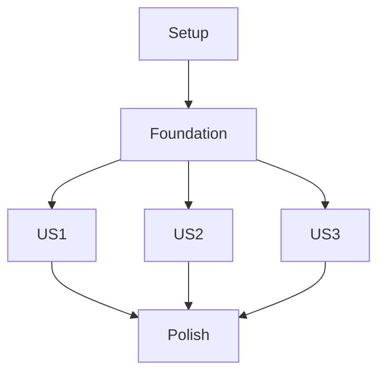

# Tasks: Places Tab and Saved Place Management

**Input**: Design documents from `/specs/004-places-tab/`

**Prerequisites**: plan.md, spec.md, research.md, data-model.md, contracts/, quickstart.md

**Tests**: Included for geofence contracts, polygon geometry, Auto tile decoding, create/delete confirmation, and failure consistency as required by the plan and constitution.

**Organization**: Tasks are grouped by user story. Run after feature 001 authentication and feature 002 map rendering/editor integration. Feature 003 can consume the location-description support delivered here and in feature 002.

## Phase 1: Setup

**Purpose**: Add geofence API and OpenFreeMap vector geometry dependencies to the Flutter app.

- [X] T001 Add or pin the Flutter vector-tile decoder dependency compatible with the feature 002 map renderer in `pubspec.yaml`.
- [X] T002 Create Places service, model, editor, and test directories in `lib/features/places/`, `lib/models/`, `lib/services/places/`, and `test/features/places/`.

## Phase 2: Foundational

**Purpose**: Implement the shared server-backed place model/repository and geometry validation used by all place stories.

- [X] T003 Define saved-place records with Traccar geofence ID, name, WKT, supported point/circle/polygon projections, and transient draft state in `lib/models/saved_place.dart` and `lib/models/place_creation_draft.dart`.
- [X] T004 Implement authenticated `GET /geofences`, `POST /geofences`, and `DELETE /geofences/{id}` operations using `name` and WKT `area` in `lib/services/places/geofence_repository.dart`.
- [X] T005 Implement geographic polygon validation for finite in-range coordinates, at least three distinct non-collinear vertices, ring closure, and WKT conversion in `lib/services/places/place_geometry.dart`.
- [X] T006 Replace the Places placeholder with the Places route and connect its saved-place projection to shared Map labels in `lib/app/app_shell.dart`, `lib/features/places/places_screen.dart`, and `lib/services/traccar_data_repository.dart`.

## Phase 3: User Story 1 - Browse and manage saved places (Priority: P1) 🎯 MVP

**Goal**: List every account-accessible saved place and delete only after named confirmation and successful server response.

**Independent Test**: Load multiple saved geofences, cancel one deletion, confirm another, and simulate a server failure; verify list and map labels match server state.

### Tests for User Story 1

- [X] T007 [P] [US1] Add geofence repository tests for authenticated list/delete requests, successful responses, and failed/uncertain network outcomes in `test/services/places/geofence_repository_test.dart`.
- [X] T008 [P] [US1] Add Places list tests for all saved entries, named delete confirmation, cancel mutation-free behavior, successful removal, and failure consistency in `test/features/places/places_screen_test.dart`.

### Implementation for User Story 1

- [X] T009 [P] [US1] Implement saved-place rows showing names and delete actions, including empty/loading/error states, in `lib/features/places/places_screen.dart`.
- [X] T010 [US1] Implement confirmation naming the selected place and update list/map state only after authenticated delete success in `lib/features/places/places_screen.dart` and `lib/services/places/geofence_repository.dart`.

## Phase 4: User Story 2 - Add a place using building data (Priority: P1)

**Goal**: Select a mapped building from OpenFreeMap base-map vector tiles, preview its outline, name it, and save it; offer Manual when no usable outline is available.

**Independent Test**: At zoom 16 or closer, select a building feature from visible vector tiles, review and save its outline, then verify it appears in the list and Map labels; verify missing tiles/outlines offer Manual.

### Tests for User Story 2

- [X] T011 [P] [US2] Add vector-tile decoding tests for building layer selection, valid outlines, duplicate tile features, invalid geometry, and absent layer in `test/services/places/building_lookup_test.dart`.
- [X] T012 [P] [US2] Add Auto editor widget tests for visible candidate highlights, selected boundary preview, naming/save, missing data, tile failure, and Manual fallback in `test/features/places/auto_place_editor_test.dart`.

### Implementation for User Story 2

- [X] T013 [US2] Implement lookup of the `building` source layer from the OpenFreeMap style already used by the base map, limited to visible map bounds and zoom 16 or closer, in `lib/services/places/building_lookup.dart`.
- [X] T014 [US2] Decode OpenFreeMap vector-tile building outlines locally and preserve feature identity/attribution without adding Overpass or a separate provider request in `lib/services/places/building_lookup.dart`.
- [X] T015 [US2] Implement selectable building highlights, outline preview, candidate selection, and clear no-result/error states in `lib/features/places/auto_place_editor.dart` and `lib/features/places/building_highlights.dart`.
- [X] T016 [US2] Implement trimmed-name validation and save the reviewed Auto boundary through the geofence repository; show list/Map changes only after success in `lib/features/places/auto_place_editor.dart` and `lib/services/places/geofence_repository.dart`.

## Phase 5: User Story 3 - Add a place by moving its corners (Priority: P1)

**Goal**: Let users create and adjust a polygon on the map, validate and name it, save it, or cancel without creating server state.

**Independent Test**: Create a valid polygon by adding/moving corners, save a non-empty name, and verify server/list/Map state; attempt invalid geometry and cancellation and verify no place is saved.

### Tests for User Story 3

- [X] T017 [P] [US3] Add geometry tests for too few, repeated, collinear, non-finite, out-of-range, closed-ring, and valid polygon cases in `test/services/places/place_geometry_test.dart`.
- [X] T018 [P] [US3] Add manual editor tests for corner add/move/remove, preview, invalid-boundary feedback, non-empty name, cancel, and successful save in `test/features/places/manual_place_editor_test.dart`.

### Implementation for User Story 3

- [X] T019 [US3] Implement manual polygon corner placement/editing and a visually distinct unsaved draft boundary in `lib/features/places/manual_place_editor.dart` and `lib/features/places/place_draft_layer.dart`.
- [X] T020 [US3] Validate the final polygon and trimmed non-empty name before save; keep invalid drafts editable and keep cancel mutation-free in `lib/features/places/manual_place_editor.dart` and `lib/services/places/place_geometry.dart`.
- [X] T021 [US3] Save manual WKT through authenticated geofence creation and update list/Map projections only after server success in `lib/features/places/manual_place_editor.dart` and `lib/services/places/geofence_repository.dart`.

## Phase 6: Polish and Cross-Cutting Concerns

- [X] T022 Verify OpenStreetMap attribution remains visible with Auto mode and Map styling in `lib/features/places/auto_place_editor.dart` and `lib/features/map/map_screen.dart`.
- [X] T023 Run focused geometry, create/delete, and failure-state tests and Android/iOS build checks; record outcomes in `specs/004-places-tab/quickstart.md`.

## Dependencies and Execution Order

### Phase Dependencies

- Depends on feature 001 authenticated setup and feature 002 map renderer, camera/editor surface, geofence projection, and shared location-description formatter.
- Setup and Foundational phases block all place stories.
- US1 can be delivered independently after the repository foundation. US2 and US3 share save/validation infrastructure but use separate editors and may proceed in parallel after T005.
- Feature 003 consumes saved-place containment/location descriptions after this feature and feature 002 are complete; this ordering avoids a People–Places implementation cycle.

### Parallel Opportunities

- T007/T008 and T009 can be developed in parallel after T003/T004.
- T011/T012 can proceed in parallel; tile decoding and Auto UI are separate files after the candidate model is fixed.
- T017/T018 can proceed in parallel; manual geometry tests can be authored independently of the map editor.

### Parallel Execution Examples

| Story | Parallel tasks |
|---|---|
| US1 | T007 and T008 (repository and UI tests are separate); T009 can be implemented independently of repository tests after the model is fixed. |
| US2 | T011 and T012 (tile decoder and Auto UI tests use separate files); T013/T014 remain sequential in the decoder file. |
| US3 | T017 and T018 (geometry and editor tests are separate); T019 editor work follows geometry validation in T020. |

## Implementation Strategy

Deliver saved-place browsing/deletion as the MVP (US1), then Auto building selection (US2), then Manual polygon editing (US3). Both creation modes share validation, naming, geofence persistence, and success-only Map updates.

## Independent Story Checks

- US1: Every authorized geofence is listed; cancel keeps it; confirmed delete changes state only on server success.
- US2: A selected building boundary is reviewed before save; missing/invalid outlines offer Manual.
- US3: Valid manual polygons save as named geofences; invalid/canceled drafts do not create server records.

## Format Validation

Every task uses a checkbox, sequential ID, optional parallel marker, required user-story label for story tasks, and a concrete repository path.
