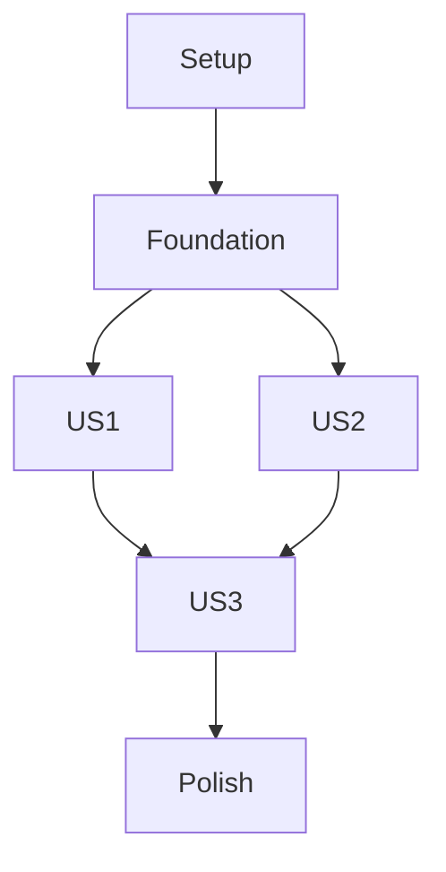

# Tasks: Settings Tab and App Reset

**Input**: Design documents from `/specs/005-settings-tab/`

**Prerequisites**: plan.md, spec.md, research.md, data-model.md, contracts/, quickstart.md

**Tests**: Included for profile/API behavior, local preference persistence, reset scope, and SDK queue preservation as required by the plan and constitution.

**Organization**: Tasks are grouped by user story. Integrate after feature 001 session setup and feature 002's shared map preference/data state; complete before feature 003 consumes shared profile presentation.

## Phase 1: Setup

**Purpose**: Add Settings-specific image selection and local preference dependencies to the Flutter app.

- [X] T001 Add compatible image selection/cropping and preference packages to `pubspec.yaml` while retaining the existing secure storage and Traccar SDK dependencies.
- [X] T002 Create Settings feature and test directories in `lib/features/settings/` and `test/features/settings/`.

## Phase 2: Foundational

**Purpose**: Establish shared profile projection, theme preference state, and safe server-detail presentation.

- [X] T003 Define Settings profile, theme, server-details, and reset request models with required trimmed display name, `system|light|dark` theme enum, optional server image filename, and secret-free server detail projection in `lib/models/user_profile.dart`, `lib/models/theme_preference.dart`, `lib/models/server_details.dart`, and `lib/models/reset_request.dart`.
- [X] T004 Implement shared Settings state/repository boundaries for authenticated Traccar user/device records and local preferences in `lib/features/settings/settings_state.dart` and `lib/services/settings/settings_repository.dart`.
- [X] T005 Replace the Settings placeholder with the final Settings destination after Map, People, and Places, and connect its state to the app-wide theme in `lib/app/app_shell.dart` and `lib/app/app_theme.dart`.

## Phase 3: User Story 1 - Update profile details (Priority: P1) 🎯 MVP

**Goal**: Change the display name and server-stored profile image and propagate confirmed values to every app surface.

**Independent Test**: Save a valid name and uploaded image, reopen Settings, and verify Map/People/Places/Settings show the new server values; cancel selection or simulate either server failure and verify the previous value remains.

### Tests for User Story 1

- [X] T006 [P] [US1] Add authenticated user-name update tests verifying only `name` changes and failed requests preserve prior state in `test/services/settings/profile_repository_test.dart`.
- [X] T007 [P] [US1] Add device-image tests for authenticated `POST /api/devices/{deviceId}/image`, returned filename persistence to `attributes.deviceImage`, image retrieval, upload/device-save failure, and server response commit behavior in `test/services/settings/profile_image_repository_test.dart`.
- [X] T008 [P] [US1] Add Settings widget tests for picture selection/cancel, upload progress, display-name validation, success propagation, and failure rollback in `test/features/settings/profile_settings_test.dart`.

### Implementation for User Story 1

- [X] T009 [US1] Implement authenticated display-name updates that preserve unrelated Traccar user fields and commit the server response only on success in `lib/services/settings/profile_repository.dart`.
- [X] T010 [US1] Implement profile image upload to the signed-in user's device, save the returned filename in `attributes.deviceImage`, and load it from the server media route in `lib/services/settings/profile_image_repository.dart`.
- [X] T011 [US1] Implement image selection/cropping and trimmed non-empty display-name editing with progress, cancel, and recoverable error states in `lib/features/settings/profile_settings_section.dart`.
- [X] T012 [US1] Publish committed profile name/image through shared profile state so Map, People, Places, and Settings consumers can render the server-confirmed values in `lib/features/settings/settings_state.dart` and `lib/models/user_profile.dart`.

## Phase 4: User Story 2 - Choose an app theme (Priority: P1)

**Goal**: Apply and persist System, Light, or Dark appearance and the Map satellite threshold, defaulting the threshold to zoom 19.

**Independent Test**: Select each theme and a satellite threshold, restart the app, and verify persistence; change OS appearance while System is selected and verify the app follows it.

### Tests for User Story 2

- [X] T013 [P] [US2] Add preference tests for `system`, `light`, and `dark` persistence, system-following behavior, default threshold 19, and threshold persistence in `test/services/settings/preferences_repository_test.dart`.
- [X] T014 [P] [US2] Add widget tests for theme choices, app-wide appearance, threshold controls, and reset-default presentation in `test/features/settings/appearance_settings_test.dart`.

### Implementation for User Story 2

- [X] T015 [US2] Implement persisted theme and satellite-threshold preferences with `system` as the new-install theme default and zoom 19 as the new-install threshold in `lib/services/settings/preferences_repository.dart`.
- [X] T016 [US2] Apply System/Light/Dark through the root Flutter theme state and propagate the selected threshold to Map in `lib/app/app_theme.dart`, `lib/app/app_shell.dart`, and `lib/features/map/map_state.dart`.
- [X] T017 [US2] Add Settings controls for the three theme options and configurable satellite-switch threshold in `lib/features/settings/appearance_settings_section.dart`.

## Phase 5: User Story 3 - Review server details and reset the app (Priority: P2)

**Goal**: Show redacted active server details and provide a confirmed local-only reset that preserves server data and queued positions.

**Independent Test**: Inspect Settings for client/manager addresses and account name without secrets; cancel reset and verify no changes; confirm reset and verify first-run routing, preserved server profile/image/places/tracking and SDK queue, cleared local session/configuration, and threshold 19.

### Tests for User Story 3

- [X] T018 [P] [US3] Add Settings detail tests for configured/unavailable endpoints and account name while ensuring passwords, tokens, and URL user-info are never rendered in `test/features/settings/server_details_section_test.dart`.
- [X] T019 [P] [US3] Add reset orchestration tests for cancel, successful cleanup, partial failure recovery, threshold restoration, first-run routing, and preservation of unrelated local/server data in `test/services/settings/app_reset_service_test.dart`.
- [X] T020 [P] [US3] Add Android and iOS bridge tests proving reset refuses to clear SDK configuration while positions are queued, then clears configuration when the queue is empty in `android/app/src/androidTest/kotlin/com/oneupbyte/trakkar/bridge/SdkConfigResetBridgeTest.kt` and `ios/RunnerTests/RunnerTests.swift`.

### Implementation for User Story 3

- [X] T021 [US3] Implement a redacted server-details section showing safely normalized client URL, manager URL, and account name or unavailable states in `lib/features/settings/server_details_section.dart`.
- [X] T022 [US3] Implement confirmed reset orchestration that stops tracking, clears only local credentials/session/endpoints/preferences and SDK connection config, preserves queued positions and server profile/image/places/tracking, and enters first-run only after success in `lib/services/settings/app_reset_service.dart`.
- [X] T023 [P] [US3] Add a narrow Android SDK configuration-reset bridge that does not clear the SDK position queue in `android/app/src/main/kotlin/com/oneupbyte/trakkar/bridge/SdkConfigResetBridge.kt` and `android/app/src/main/kotlin/com/oneupbyte/trakkar/MainActivity.kt`.
- [X] T024 [P] [US3] Add the matching iOS SDK configuration-reset bridge that does not clear the SDK position queue in `ios/Runner/SdkConfigResetBridge.swift` and `ios/Runner/AppDelegate.swift`.
- [X] T025 [US3] Implement reset confirmation copy, server details placement, progress, success routing, and recoverable partial-failure state in `lib/features/settings/reset_settings_section.dart` and `lib/app/app_router.dart`.

## Phase 6: Polish and Cross-Cutting Concerns

- [X] T026 Verify reset never deletes server profile images, geofences, account data, SDK queue data, or unrelated local files in `lib/services/settings/app_reset_service.dart` and the Android/iOS bridge tests.
- [X] T027 Run focused Settings tests plus Android/iOS build checks, and document SDK queue-preservation and device/live-server verification limits in `specs/005-settings-tab/quickstart.md`.

## Dependencies and Execution Order

### Phase Dependencies

- Depends on feature 001 authentication, secure session, app router, and Flutter scaffold; depends on feature 002's shared map-threshold model and data surfaces.
- Setup and Foundational phases block all Settings stories.
- US1 and US2 are independent after the foundation. US3 consumes both preferences and profile/server state, then coordinates the SDK reset bridge.
- Feature 003 consumes the shared profile presentation after Settings US1; all four bottom-tab destinations should be registered before final navigation integration.

### Parallel Opportunities

- T006/T007/T008 can proceed in parallel after the API boundary is fixed.
- T013/T014 can proceed in parallel; preference implementation is separate from UI tests.
- T018/T019 and Android/iOS bridge test work can proceed in parallel; the native bridge files are platform-separated.

### Parallel Execution Examples

| Story | Parallel tasks |
|---|---|
| US1 | T006/T007/T008 (name API, image API, and UI test files are separate). |
| US2 | T013 and T014 (preference and widget tests are separate); theme persistence T015 is followed by UI integration T017. |
| US3 | T018/T019/T020 (details, reset orchestration, and native bridge tests are separate); T023 and T024 can be implemented in parallel on Android/iOS. |

## Implementation Strategy

Deliver profile identity editing as the MVP (US1), then theme/map appearance preferences (US2), then server details and the carefully bounded reset (US3). Do not report reset success unless both platform configuration cleanup and position-queue preservation are verified.

## Independent Story Checks

- US1: Server-committed name and image update across views; cancellation/failure leaves previous values intact.
- US2: All three theme modes and threshold persist; new threshold starts at 19.
- US3: Passwords remain hidden; cancel is mutation-free; confirmed reset clears only local setup, preserves server data and queued positions, and returns to onboarding only after success.

## Format Validation

Every task uses a checkbox, sequential ID, optional parallel marker, required user-story label for story tasks, and a concrete repository path.
